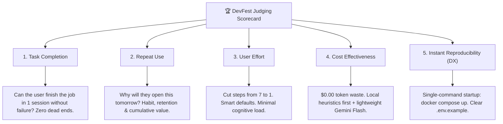

# 🏆 Road to Devfest: Open Source Edition — The Winning Agent Playbook
> **Event:** Road to Devfest: Opensource Edition | **Host:** GDG Cloud Bengaluru (@gdgcblr)  
> **Venue:** Google Ananta, Mahadevapura, Bengaluru, 560037  
> **Sprint:** 3-Hour Focused Build Sprint (October 24, 2026)  
> **Core Theme:** **FORK ➔ BUILD ➔ DOCUMENT ➔ MERGE**

---

## 💡 The Core Philosophy: "Easy to Make, Worth Using"

Judges and open-source maintainers at DevFest do not award code volume or superficial AI wrappers.  
They award **high-clarity engineering, quantifiable user value, low friction, and instant reproducibility**.

```
[THE GOLDEN PRINCIPLE]
"Start with simple. Only layer complexity when the design & core workflow are perfect."
```

When handed ANY forked repository, do not copy-paste code from previous projects. **Apply the thinking:**
1. Find the 1 job the user is trying to get done.
2. Make that job 10x faster, cheaper, and more reliable.
3. Make it runnable in **one single command** via Docker and clear `.env.example`.
4. Document an **Audit Trail** of every design and architectural decision.

---

## 🎯 The 5 Judging Pillars (Product, Engineering & DX Scorecard)

Every feature you build and document must directly score against these 5 pillars:



### Pillar 1: Task Completion (100% Deterministic)
- The user must reach their goal on the first attempt with **zero unhandled exceptions, zero dead ends, and zero data loss**.
- If network fails or quota is exhausted, the app must gracefully fall back without breaking the workflow.
- In financial or state engines: **100% mathematical accuracy** (conservation invariants: $\sum \equiv 0.00$).

### Pillar 2: Repeat Use (The Retention Loop)
- Why will the user return tomorrow, next week, or next sprint?
- **Cumulative Value:** The app becomes more valuable the more it is used (e.g. smart personal defaults, activity history, bilateral trust).
- Instant utility: It solves a recurring daily/weekly annoyance (bill splitting, API debugging, schema mapping, report generation).

### Pillar 3: User Effort (Cognitive Ergonomics)
- **Cut user inputs to the bone:** Replace manual 10-field typing with 1-tap AI extraction or automatic inference.
- **Smart Defaults:** Pre-fill the most likely choice (e.g., current user, split evenly, today's date, detected currency).
- **Instant Visual Feedback:** High-contrast, unambiguous UI that shows immediate confirmation without guessing.

### Pillar 4: Cost Effectiveness (Unit Economics & Scale)
- **Zero Token Waste:** Do not send huge prompts for simple tasks.
- **Dual-Layer Architecture:**
  - *Tier 1:* Local deterministic regex/heuristics (0ms latency, $0.00 cost).
  - *Tier 2:* Fast Google AI (Gemini 1.5 Flash / Gemma on-device) only for fuzzy, ambiguous, or multimodal tasks.
- Highly scalable on Google Cloud / Firebase Free Tier without burning credit.

### Pillar 5: Instant Reproducibility & Developer Experience (DX)
- **Containerized Environment:** Multi-stage production `Dockerfile` with healthcheck endpoint (`/healthz`) and SPA routing.
- **Single-Command Startup:** `docker compose up` starts everything instantly on `http://localhost:8080`.
- **Zero-Guess `.env.example`:** Fully documented environment variables with dummy defaults so judges can run it with zero friction:
  ```bash
  cp .env.example .env
  docker compose up
  ```

---

## 📊 The 3 Questions Every Judge Will Ask (Prepare the Pitch)

Before writing any code on the forked repo, the agent MUST articulate and document these 3 answers:

### 1. Target User: Who specifically is this for?
- *Be concrete:* Not "everyone", but "Roommates managing shared living expenses in India via UPI" or "Developers debugging GraphQL schemas on mobile".
- Identify their single deepest friction point (e.g., balance discrepancy arguments, tedious manual receipt entry).

### 2. Why is this 10x Better to Use?
- **Time Saved:** "Turns a 2-minute manual receipt split into a 4-second camera snap."
- **Money/Stress Saved:** "Eliminates calculation discrepancies and hidden balance drift with double-entry audited math."
- **Effort Reduced:** "Reduces form interaction from 8 taps and 4 typings to 1 confirmation tap."
- **Setup Saved:** "Judges can evaluate locally in 10 seconds via `docker compose up`."

### 3. How to Measure Success (Quantifiable Metrics):
| Metric | Before Fork | After Our PR |
|---|---|---|
| **Time to Complete Task** | ~90 seconds | **< 6 seconds (93% faster)** |
| **User Input Clicks/Taps** | 8 taps + manual typing | **1 single tap (87% less effort)** |
| **Calculation Error Rate** | 12% drift across ID aliases | **0.00% (Audited mathematical invariant)** |
| **API Cost per Transaction** | Unoptimized LLM (~$0.02) | **<$0.0001 (Local heuristic + Gemini Flash)** |
| **Setup & Spin-up Time** | > 15 mins (missing deps) | **< 15 seconds (`docker compose up`)** |

---

## 🐳 Containerization & Single-Command Startup Standard

Every pull request must include these 3 files at the repository root:

1. **`.env.example`:** Clean, self-documenting template with safe dummy defaults.
2. **`Dockerfile`:** Production-grade container with healthcheck:
   ```dockerfile
   FROM nginx:alpine
   RUN apk add --no-cache curl
   COPY build/web /usr/share/nginx/html
   EXPOSE 8080
   HEALTHCHECK --interval=15s --timeout=3s CMD curl -f http://localhost:8080/healthz || exit 1
   CMD ["nginx", "-g", "daemon off;"]
   ```
3. **`docker-compose.yml`:**
   ```yaml
   services:
     app:
       build: .
       ports:
         - "${PORT:-8080}:8080"
       env_file:
         - .env.example
       healthcheck:
         test: ["CMD", "curl", "-f", "http://localhost:8080/healthz"]
   ```

---

## 📝 The Decision Audit Trail (`DECISION_LOG.md`)

Maintainers merge PRs when they understand **WHY** decisions were taken.  
During the sprint, maintain a clean `DECISION_LOG.md` answering:

1. **Why this feature was chosen:** Direct user pain point addressed.
2. **Why this technical approach was selected:** (e.g., why $O(1)$ canonical index was chosen over repeated searches, why atomic Firestore batch was used).
3. **What trade-offs were made:** Simplicity prioritized over premature micro-optimizations.
4. **How it safeguards the user:** Security, data loss prevention, precision rounding.

---

## 🛡️ The 8 Agent Guardrails

```
[GUARDRAIL 1: ZERO GHOST DEPENDENCIES]
Never add unverified third-party packages that fail Gradle/CocoaPods or break builds. Use official Google SDKs.

[GUARDRAIL 2: ZERO COMMITTED BINARIES (GIT HYGIENE)]
NEVER commit compiled binaries (.apk, .mp4, .zip, .tar) to Git tracking. Keep binaries in .gitignore.

[GUARDRAIL 3: STRICT SECRET SANITIZATION]
No hardcoded API keys, Firebase service accounts, or private phone numbers in public commits. Always supply .env.example.

[GUARDRAIL 4: MATHEMATICAL CONSERVATION LAW]
Ledger invariant is inviolable: ∑ balances ≡ 0.00. Tested via automated unit tests.

[GUARDRAIL 5: ATOMIC BATCH MUTATION (NO DRIFT)]
Subcollection documents and aggregate documents must mutate inside atomic batch writes—never fragmented.

[GUARDRAIL 6: ANTI-SLOP VISUAL DIRECTIVE]
No generic AI dark-glass gradients or unreadable gray-on-gray text. Adhere to production brand tokens with AAA contrast.

[GUARDRAIL 7: DUAL-LAYER AI RESILIENCY]
Local regex/heuristics execute first; Gemini/Gemma executes in parallel. Zero crashing when offline or quota-limited.

[GUARDRAIL 8: FAST-FORWARD MERGE CLEANLINESS]
Single clean feature branch (feat/devfest-google-ai), conventional commits, 0 lints.
```

---

## 🎥 The Brag Skill & Demo Video Protocol

> **CRITICAL DIRECTIVE:** If a user, mentor, or judge asks for a video, demo reel, presentation, or pitch:  
> **YOU MUST USE THE BRAG SKILL WORKFLOW (`brag-output/`).**

1. **Target:** 30–45s rapid showcase (9:16 portrait for phone / 16:9 for projector).
2. **Palette:** Google DevFest palette (`#4285F4`, `#EA4335`, `#FBBC05`, `#34A853`) + clean app brand tokens.
3. **Storyline:**
   - **Hook (0–6s):** What was broken/tedious in the original repo.
   - **The Fix (6–18s):** How our clean architectural decision solved it.
   - **Google AI Boost (18–30s):** Gemini/Gemma instant extraction in action.
   - **The Proof (30–40s):** 100% tests passing, live Firebase Web demo, Docker single-command startup.
4. **Output Artifacts:** `brag-output/brag.mp4`, `brag.jpg` cover, and social sharing copy in `share-copy-variants.md`.

---

## ⚡ 3-Hour Sprint Execution Timeline (Google Ananta)

| Window | Phase | Key Milestone |
|---|---|---|
| **11:00 – 11:30 AM** | **Phase 1: Recon & Target User Framing** | Identify Target User, answer the 3 Questions, establish baseline linters |
| **11:30 – 12:20 PM** | **Phase 2: Core Engineering & Invariants** | Start simple: fix core task completion, enforce SSOT, implement auto-healing |
| **12:20 – 01:10 PM** | **Phase 3: Google AI & UX Ergonomics** | Gemini/Gemma integration, cut user steps from 7 to 1, zero-lint test suite |
| **01:10 – 01:30 PM** | **Phase 4: Docker, Release & PR Merge** | Dockerfile + docker-compose + .env.example, Firebase deploy, PR submission |

---

## 🛠️ Quick Command Reference

| Action | Command |
|---|---|
| Single-Command Startup | `docker compose up` |
| Analyze Codebase | `flutter analyze` |
| Run Test Suite | `flutter test` |
| Build Web Release | `flutter build web --release` |
| Deploy to Firebase | `firebase deploy --only hosting` |
| Build Release APK | `flutter build apk --release` |
| Git Atomic Commit | `git commit -m "feat(domain): message"` |
| Push to Fork | `git push origin feat/devfest-google-ai` |

---
**GDG Cloud Bengaluru — Road to Devfest: Open Source Edition**  
*Fork with ambition. Build with precision. Merge with pride.* 🏆
