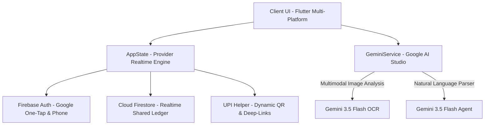

# 📊 Bharat Dues — Project Overview & Architecture

## 🎯 Executive Summary
**Bharat Dues** is a cross-platform fintech solution designed to eliminate friction from group finances in India. Combining **Flutter**, **Firebase**, and **Google Gemini 3.5 Flash**, it addresses the core pain points of traditional expense splitters: tedious manual bill typing, complicated debt graphs, awkward payment reminders, and fragmented UPI settlement flows.

---

## 🏛️ System Architecture

### 1. Presentation Layer (Flutter Multiplatform)
- **`app_shell.dart`**: Unified navigation managing Global Dashboard (Friends & Activity tabs) and Group screens.
- **`group_settlement_screen.dart`**: The core ledger interface featuring live member balances, debt simplification cards, expense lists, and the **AI Split** FAB.
- **`gemini_ai_dialogs.dart`**: Modern Material 3 bottom sheets for conversational expense prompts, camera/gallery receipt scanning, and Google AI Studio key configuration.

### 2. AI Intelligence Layer (`gemini_service.dart`)
- **Multimodal Receipt Parsing**:
  - Encodes receipt images to bytes (`DataPart('image/jpeg', bytes)`).
  - Prompts `gemini-3.5-flash` with strict JSON schema.
  - Automatically maps extracted vendor details, line items, and totals into `Expense` model objects.
- **Conversational Split Parsing**:
  - Ingests free-form text or voice transcripts.
  - Injects current group roster into context.
  - Returns fuzzy-matched payer, participant IDs, split mode (equal vs exact), and category.
- **Resilient Fallback Engine**:
  - Prioritizes `gemini-3.5-flash` ➔ `gemini-3.6-flash` ➔ `gemini-3.8-flash`.

### 3. Business Logic & State Layer (`app_state.dart`)
- Stream-based reactivity with Firestore snapshots.
- Greedy Debt Simplification algorithm reducing N-way transactions to minimal settlements.
- Double-precision financial calculation engine with epsilon validation (`< 0.01`).

### 4. Settlement & Payments (`upi_helper.dart`)
- Launches native UPI apps (`gpay`, `phonepe`, `paytm`, `cred`) using standardized `upi://pay` intents.
- Generates on-the-fly dynamic UPI QR codes using `qr_flutter` encoded with exact rupee amounts.

---

## 🔒 Security & Data Integrity
- **Firestore Security Rules**: Role-based group access ensuring only validated group participants can read/write ledger entries.
- **Local Key Storage**: API keys stored client-side via encrypted `SharedPreferences`, ensuring zero server telemetry of user keys.
- **Epsilon Balance Checking**: Invariants enforced so the sum of individual shares always matches the total expense amount within 1 paisa.
